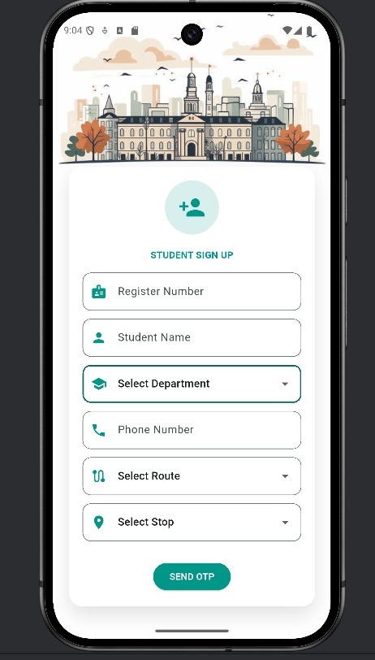

# 🚌 GPS-Based Smart Bus Tracking System

A college transportation application designed to help students track college buses, view bus status, and stay informed about transportation updates.

## 🚀 Project Overview

The system uses GPS location data and Firebase Realtime Database to provide live bus-location updates. It includes separate student and driver interfaces.

## ✨ Key Features

- **Live Bus Tracking:** View the current bus location using GPS data.
- **Student Application:** Access bus information and transportation updates.
- **Driver Application:** Driver-facing interface for bus-related operations.
- **Bus Stop Management:** Store bus-stop latitude and longitude details in MongoDB.
- **Notifications:** Display bus-related notifications and status updates.
- **Issue Reporting:** Report issues such as bus breakdowns and accidents.

## 🛠️ Technologies Used

- GPS – Location tracking
- Firebase Realtime Database – Live bus-location updates
- MongoDB – Bus-stop latitude and longitude data
- Backend – Server-side processing and database integration

## 📸 Application Screenshots

### 1. Student Application

### 2. Student Sign In

### 3. Live Bus Status

### 4. Driver Application

### 5. Notifications

### 6. Bus Issue Reporting

## 🎯 Project Objective

To improve college transportation visibility by providing students with bus-location information and timely updates, while supporting drivers through a dedicated application interface.
